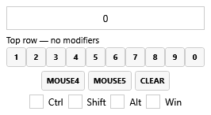

# Hotkey implementation and verification

## Change inventory

| Area | Changes |
| --- | --- |
| Input model | Mouse4/Mouse5 bindings, canonical config parsing, separate human-readable key labels |
| Global/local input | Non-suppressing MouseKeyHook down/up adapter; deterministic duplicate selection; repeat, modifier-order and focus handling |
| Playback mode | Per-sound Hold to play, existing Loop integration, no held Next Sound chaining |
| Playback lifecycle | Async file preparation, request generations, cancellation of pending starts/loads, request-local reader disposal, stale callback guards |
| UI | Explicit side-button and bare number-row selectors; modifier checkboxes; Hold toggle in picker/context menu; large clickable tile badges; integrated volume-offset footer |
| Persistence | Backward-compatible `holdToPlay` attribute, saved/undoable edits, copied/swapped/imported/exported state |
| Tests | Dependency-free input/config test executable and real WPF number-picker smoke test |
| Documentation | Usage guide, input propagation risks, elevated-process drag-and-drop troubleshooting |

No new runtime packages or .NET version migration are required. The app remains a classic .NET Framework 4.8 WPF project.

## Pre-submission review fixes

The PR branch additionally fixes three code-review findings: a normal tile/chain start now detaches the old hold activation before taking playback ownership; playback-time warning updates reuse background reader preparation instead of synchronously opening another codec; and progress no longer treats a reader position of zero as completion before the first sample is read. File-existence checking also runs off the UI thread. The input regression suite covers old-hold/new-playback ownership. These fixes are in the PR branch; the existing installed custom binary was not silently replaced.

## Input and playback design

`HotkeyInputState<T>` is independent of WPF and audio. It tracks physical primary-key edges and captures the selected target at press time. Modifier changes do not rearm a held input; release is matched to the original primary key, not the modifiers at release. Stop/editor cancellation invalidates activations while retaining physical-down entries to prevent repeat retriggers. Overlapping bindings for one held target share ownership.

`SoundHotkeyService` adapts the existing MouseKeyHook library to that state machine. It enqueues playback work on the dispatcher rather than decoding audio inside the hook, checks missed releases periodically, and reacts to session/power changes. Hook callbacks never suppress foreground keys or mouse buttons. This deliberately changes global keyboard behavior from exclusive `RegisterHotKey` registration to shared input monitoring; it is not limited to newly assigned mouse keys.

`SoundButton.StartSound` prepares request-local readers off the UI thread. A `PlaybackGate` generation plus input-activation validity checks prevent a canceled request from starting playback afterward. Stop, release and configuration reload invalidate pending work. Completion handlers verify the active request and do not follow Next Sound after explicit cancellation or held playback. The existing LoopStream does not own its reader, so cleanup disposes request-local readers explicitly.

The hotkey badge is a real nested WPF Button. Its click opens the same picker as the context menu, marks the routed click handled, and bypasses parent tile selection/drag handling for that subtree. Sound-name clicks retain normal playback behavior. Display strings (`1`, `Num 1`, `Mouse 4`) are independent of persisted strings (`D1`, `NumPad1`, `Mouse4`).

## Build and automated tests

Requirements: Windows, Visual Studio or Build Tools with **.NET desktop build tools**, the **.NET Framework 4.8 targeting pack**, and Windows PowerShell. A `dotnet` SDK is not required. NuGet restore needs network access on the first build.

From the repository root:

```powershell
powershell.exe -NoProfile -ExecutionPolicy Bypass -File .\SoundBoard.InputTests\run-tests.ps1
```

This discovers MSBuild through `vswhere`, restores/builds the Release application, builds/runs the standalone console tests, then starts the WPF smoke test in a separate STA process. The execution-policy argument affects only that process; it does not change machine policy.

The console project links the production input-state and hotkey model files, with no test-framework packages. Its initial Windows run covers 23 test cases: side buttons, key repeats, modifier-first release, focus changes, editor suppression, duplicate ownership, overlapping holds, local/global normal semantics, cancellation generations, top-row versus numpad keys and config-string round trips.

`WindowsUiSmoke.ps1` loads the actual built EXE, sets `Application.ResourceAssembly`, initializes resources without calling `Application.Run`, and exercises all ten real number-selector buttons with routed clicks. It checks that each selects its matching top-row key and clears modifiers, then renders the real picker to `SoundBoard.InputTests/bin/Release/number-picker-proof.png`. It does not instantiate the main window, install input hooks, read/write the user's sound configuration, or send keyboard/mouse events to other applications.

A platform-independent subset can also run with Mono, excluding the Windows-specific model tests:

```sh
mcs -warnaserror -out:SoundBoard.InputTests.exe SoundBoard/Hotkeys/HotkeyInputState.cs SoundBoard.InputTests/Program.cs
mono SoundBoard.InputTests.exe
```

## Verification performed

- Full Release build and 23 console tests passed on Windows with .NET Framework 4.8 and Visual Studio MSBuild.
- All ten actual WPF number-picker buttons selected modifier-free top-row keys; the picker was rendered and inspected for clipping.
- In the installed local feature build, clicking a large badge opened Set Hotkeys; Cancel returned to the main grid. Both picker sections, Hold and confirmation controls fit in the existing window.
- Main-grid screenshots showed readable key labels and long sound names. Volume offsets were moved into the badge footer after identifying overlap with the old icons.
- Existing sound entries, routing and subsequently user-edited bindings remained available after restarts. Windows' ADMIN indicator disappeared after relaunching with a normal user token.

The isolated picker image below is generated from the real WPF control, not a mockup, and contains no personal sound library or machine paths:



## Manual acceptance still needed

Automated state tests do not prove physical device input, game/voice delivery, or every playback/persistence path. Before release, verify:

- [ ] Physical Mouse4/5 and keyboard down/up with and without modifiers, while focused and unfocused.
- [ ] Release modifiers before the primary button; release/press quickly during large-file preparation; Stop All during a hold/load.
- [ ] Loop on/off while held, normal playback, pause/resume, multi-output playback and normal Next Sound chains.
- [ ] Open an editor while holding, change/clear bindings, close while still down, then release and re-press.
- [ ] Save/restart, copy/swap/undo and export/import with mouse/number bindings and hold mode; legacy configs default to normal mode.
- [ ] Actual suspend/lock/unlock, lost-release recovery and app shutdown while playing.
- [ ] Actual Explorer file drop while unelevated, and tile rearrangement away from the editable badge.
- [ ] Different window/grid sizes, long modifier combinations, both scopes and DPI scaling.
- [ ] Any target game's physical hotkeys and teammate-heard voice-chat audio, without disturbing an active match.

These are pending manual checks, not claimed passes. CI status should be read from the PR; this repository previously had no checked-in workflow for these tests.

## Local custom build versus upstream PR

The initially installed development build had a custom window/About/version label and disabled upstream update checks to avoid overwriting unreleased features with an official binary. Those were **local deployment safeguards**, not part of the requested upstream behavior.

This contribution restores the original application name, assembly/version metadata, About dialog and automatic/manual update behavior. The functional hotkey/playback/UI changes and tests remain. The installed custom build is not replaced by preparing this PR.

The drag-and-drop incident was resolved by restarting that local app unelevated; it did not require weakening UAC, changing Explorer, or modifying the app manifest. Its explanation is documented in the usage guide rather than presented as an unrelated code fix.
